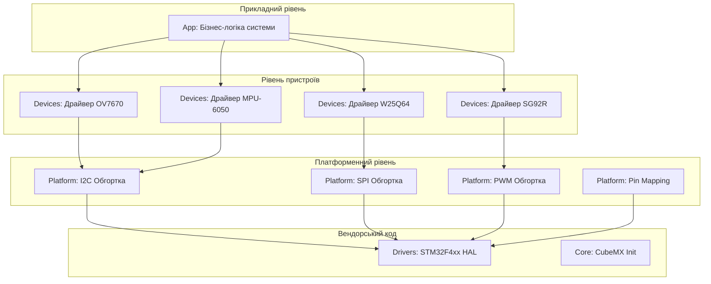

# Архітектура програмного проєкту

## 1. Діаграма компонентів (Component Diagram)
Нижче наведено структуру шарів нашого проєкту. Стрілки вказують напрямок залежностей.

## 2. Опис шарів та правила залежностей

Проєкт побудовано за принципом суворої шаруватої архітектури. Залежності можуть бути спрямовані виключно зверху вниз.

*   **App (Прикладний рівень):** Містить головну логіку продукту. Цей шар нічого не знає про мікроконтролер, його регістри чи бібліотеку HAL. Він оперує виключно сутностями з шару `Devices` (наприклад, "отримати температуру", "встановити кут сервопривода").
*   **Devices (Драйвери сенсорів):** Містить логіку роботи з конкретними чіпами (читання регістрів ID, розрахунок фізичних величин). Драйвери є платформонезалежними і можуть бути перенесені на інший МК.
*   **Platform (Адаптація до плати):** Єдиний шар, де зберігається знання про конкретну плату (номери пінів, хендли периферії, такі як `hi2c1`, `hspi2`). Цей шар надає універсальні інтерфейси (наприклад, `Platform_I2C_Read()`), які всередині викликають функції HAL.
*   **Drivers & Core:** Згенерований вендорський код (STM32CubeMX). 

## 3. Автоматичний контроль
Для того, щоб унеможливити порушення архітектури, у проєкті реалізовано автоматичну перевірку правила залежностей `make check-arch`. Ця команда зупиняє збірку з помилкою, якщо знаходить підключення заголовків HAL у прикладному шарі.

## 4. Доступ до шини
Драйвер сенсора (шар `Devices`) не викликає `HAL_I2C_Mem_Read` напряму. Натомість він отримує доступ до шини через абстрактні інтерфейси або вказівники на функції, що реалізовані у шарі `Platform`. Завдяки цьому драйвери легко тестувати на хості, замінивши реальні функції доступу до шини на fake або mock-об'єкти.