# Аналіз записів логічного аналізатора

## 1. Умови запису

Записи зроблені 8-канальним логічним аналізатором з максимальною частотою дискретизації 24 МГц у PulseView. Тригер не використовувався: запис запускався кнопкою Run у PulseView, після чого плату перезапускали кнопкою RESET на Nucleo, а потрібна ділянка знаходиться за часом. Частота для кожного запису обрана мінімальною, але з запасом для найшвидшого сигналу.

| Файл | Частота | Тривалість | Що відбувається в записі | Експорт анотацій |
|---|---|---|---|---|
| `pwm_init_test.sr` | 20 кГц | 13,6 с | старт прошивки, прохід сервопривода 0° → 90° → 180° | `pwm_init_test_export.txt` |
| `i2c_init_temp_check.sr` | 8 МГц | 12,5 с | читання температури, перезапуск плати, скан шини, ID датчиків, ініціалізація камери по SCCB | `i2c_init_temp_check_export.txt` |
| `sccb_init_snap_check.sr` | 8 МГц | 25 с | перезапуск плати, ініціалізація камери, потік кадрів, команда `SNAP` | `sccb_init_snap_check_export.txt` |
| `spi_init_ferase_test.sr` | 4 МГц | 25 с | команди `FINIT` і `FERASE 1` | `spi_init_ferase_test_export.txt` |

| Канал | D0 | D1 | D2 | D3 | D4 |
|---|---|---|---|---|---|
| `pwm_init_test.sr` | PWM, PA6 | | | | |
| `i2c_init_temp_check.sr` | SCL, PB8 | SDA, PB9 | | | |
| `sccb_init_snap_check.sr` | SCL, PB8 | SDA, PB9 | VSYNC, PA1 | PCLK, PA0 | HREF, PA4 |
| `spi_init_ferase_test.sr` | MISO, PB14 | CS#, PB12 | MOSI, PB15 | SCK, PB13 | |

Експорт отримано в PulseView за допомогою Export all annotations. Числа на початку рядка експорту це номери відліків; поділені на частоту дискретизації, вони дають час від початку запису. Декодери: `i2c` для I2C і SCCB, `spi` для SPI, `pwm` для PWM. Значення з позначкою «курсор» виміряні курсорами PulseView і видні на рисунках, решта взята з експорту.

Два сигнали записати неможливо: XCLK камери і SCK SPI при старті прошивки, обидва 21 МГц. Для них потрібно більше 42 МГц, а для надійного декодування в 4-5 разів більше, тобто понад 100 МГц. Аналізатор на 24 МГц цього не дає, тому XCLK і SPI на стартовій частоті перевіряються лише опосередковано (розд. 4 і 5).

Усі часові параметри нижче на 1,3 % коротші за розрахункові. Прошивка тактується від внутрішнього RC-генератора HSI, а не від кварцу (розд. 6), тож усі шини, таймери і `HAL_Delay` біжать на 1,3 % швидше. Там, де це важливо, у таблицях наведено розрахункове значення з цією поправкою.

## 2. I2C: MPU6050 і GY-89

```
   143,4 мс  S 68 W ACK 41 ACK Sr 68 R ACK F1 ACK 80 NACK P   температура, F180 = 25,61 °C
  1130,3 мс  S 68 W ACK 41 ACK Sr 68 R ACK F1 ACK 80 NACK P   наступне читання через 986,4 мс
  1966,9 мс  S 01 W NACK P ... S 7F W NACK P                   I2C_Scan після перезапуску
             ACK лише на 1D, 68, 6B, 77
  4978,3 мс  S 68 W ACK 75 ACK Sr 68 R ACK 68 NACK P           MPU6050 WHO_AM_I
  4981,6 мс  S 68 W ACK 6B ACK 00 ACK P                        PWR_MGMT_1 = 0, вихід зі сну
  4989,3 мс  S 1D W ACK 0F ACK Sr 1D R ACK 49 NACK P           LSM303D WHO_AM_I
  4992,2 мс  S 6B W ACK 0F ACK Sr 6B R ACK D4 NACK P           L3GD20 WHO_AM_I
  4995,0 мс  S 77 W ACK D0 ACK Sr 77 R ACK 55 NACK P           BMP180 chip id
  7812,8 мс  S 68 W ACK 41 ACK Sr 68 R ACK F1 ACK A0 NACK P   температура, F1A0 = 25,71 °C
  ...        далі щосекунди: F180, F190, F1B0, F180
```

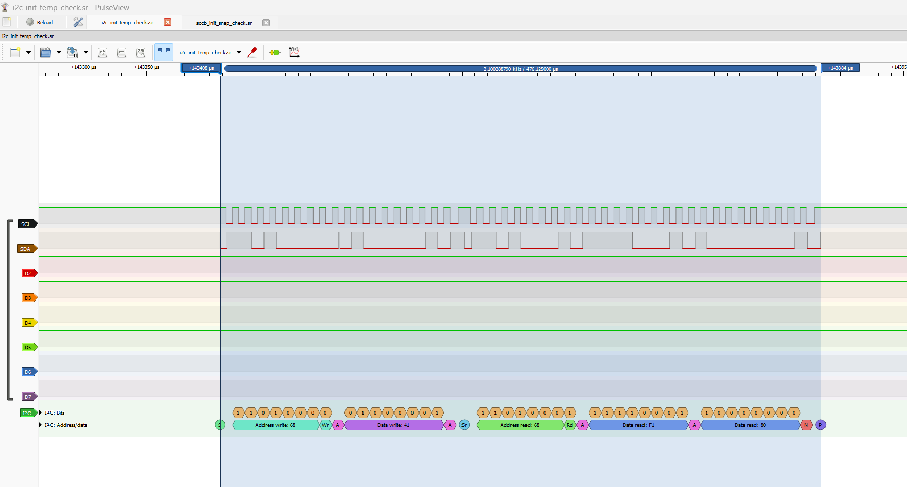

Рисунок 1. Читання температури MPU6050: два байти одним зверненням, тривалість транзакції 476,1 мкс (курсор).

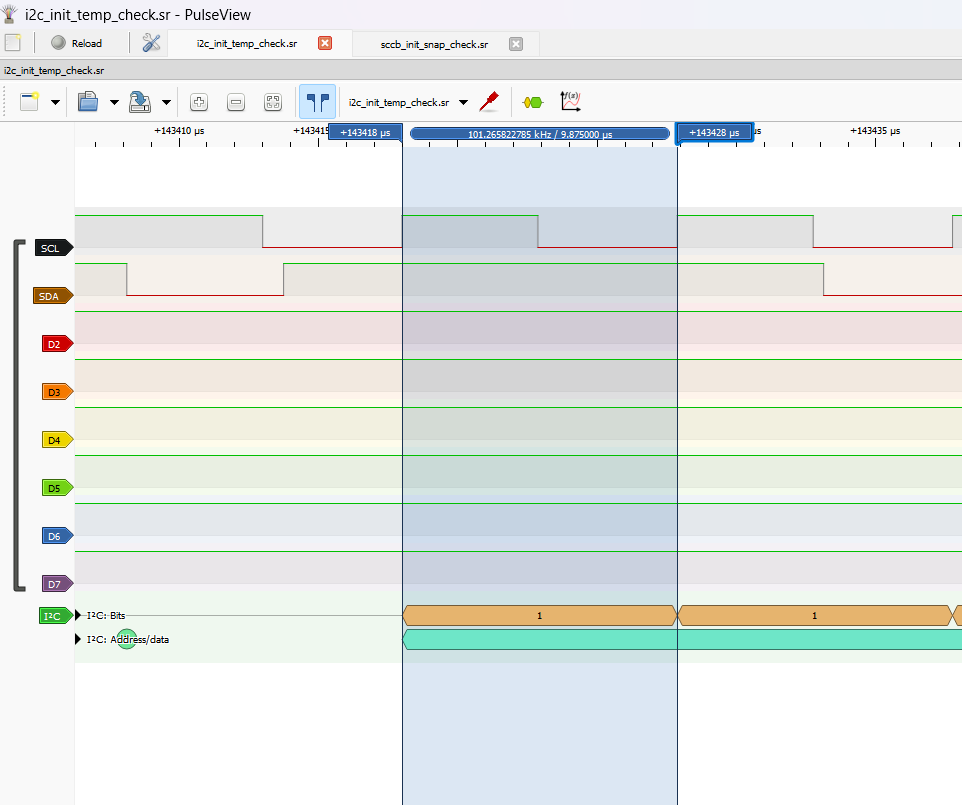

Рисунок 2. Період SCL між двома зростаючими фронтами: 9,875 мкс, 101,3 кГц (курсор).

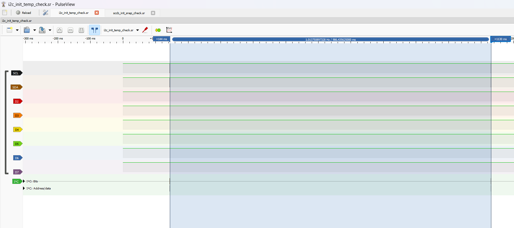

Рисунок 3. Два сусідні читання температури, інтервал 986,4 мс (курсор).

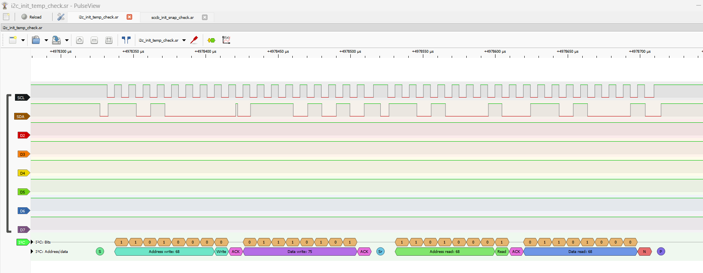

Рисунок 4. Читання регістра WHO_AM_I: MPU6050 повертає 0x68.

На шині чотири пристрої, і кожен відповідає на свою адресу: MPU6050 на 0x68 (AD0 = 0), LSM303D на 0x1D і L3GD20 на 0x6B (виводи SA0 і SDO на модулі GY-89 підтягнуті до 1), BMP180 на фіксованій 0x77 (LSM303D[pg:22]; L3GD20[pg:23]; BMP180[pg:20]). Решта адрес скану дає NACK. Камера 0x21 у скані теж не відповідає: скан іде до запуску XCLK, а без тактового сигналу OV7670 мовчить (розд. 3).

Ідентифікація збігається з документацією. WHO_AM_I MPU6050 (регістр 0x75) має значення 0x68 (MPU-6000[pg:45]), LSM303D і L3GD20 повертають з регістра 0x0F 0x49 і 0xD4 (LSM303D[pg:31]; L3GD20[pg:31]), BMP180 з регістра 0xD0 повертає 0x55 (BMP180[pg:18]).
Читання температури це багатобайтове читання: прошивка пише адресу регістра 0x41 (TEMP_OUT_H), робить повторний START і читає два байти, а MPU6050 сам переходить до 0x42 (TEMP_OUT_L). Контролер підтверджує перший байт і відповідає NACK на другий, бо більше не читатиме. Температура дорівнює TEMP_OUT / 340 + 36,53 (MPU-6000[pg:30]): для F180 це −3712 / 340 + 36,53 = 25,61 °C, для F1A0, F190 і F1B0 відповідно 25,71, 25,66 і 25,75 °C. Це температура кристала MPU6050, і вона правдоподібна для кімнати. Запис 0x00 у PWR_MGMT_1 одразу після WHO_AM_I потрібен, бо MPU6050 після подачі живлення перебуває в режимі сну (MPU-6000[pg:9,40-41]).

| Параметр | Очікуване значення | Виміряне значення |
|---|---|---|
| Період SCL | CCR = 42 МГц / (2 · 100 кГц) = 210, 2 · 210 / 42 МГц = 10,00 мкс (RM0383[pg:499]); з поправкою HSI 9,87 мкс | 9,875 мкс, 101,3 кГц (курсор) |
| Низький рівень SCL | 210 / 42 МГц = 5,0 мкс; не менше 4,7 мкс (UM10204[pg:44]) | 5,000 мкс |
| Високий рівень SCL | 5,0 мкс; не менше 4,0 мкс (UM10204[pg:44]) | 4,875 мкс |
| Читання температури | 45 тактів SCL ≈ 444 мкс, плюс START, Sr і STOP | 476,1 мкс (курсор) |
| Читання WHO_AM_I | 36 тактів ≈ 356 мкс, плюс START, Sr і STOP | 387,5 мкс |
| Звертання скану | 9 тактів ≈ 89 мкс, плюс START і STOP | 105,0 мкс |
| Крок між адресами скану | | 110,2 мкс, пауза 5 мкс |
| Пауза після знайденої адреси | `printf` 62 байтів на 115200 бод ≈ 5,3 мс | 5,85 мс |
| Від WHO_AM_I до запису PWR_MGMT_1 | `printf` 31 байта ≈ 2,7 мс | 2,92 мс |
| Інтервал читань температури | 1001 тік `HAL_GetTick` ≈ 988 мс з поправкою HSI | 986,4 мс (курсор) |

Високий рівень SCL на записі трохи коротший за низький, хоча за налаштуванням вони однакові. Причина в тому, як працює лінія I2C: вниз її активно тягне сам пристрій, і вона падає майже миттєво, а вгору її піднімає лише резистор, і напруга росте поступово. Аналізатор фіксує 1, лише коли напруга дорісла до порогу, тому високий рівень для нього починається трохи пізніше. Обидва значення з запасом відповідають вимогам стандарту I2C до швидкості 100 кГц.

Паузи на шині показують, де прошивка зайнята іншим. Між адресами скану минає лише 5 мкс виходу з одного виклику `HAL_I2C_IsDeviceReady` і входу в наступний. Після знайденої адреси і після WHO_AM_I шина стоїть рівно стільки, скільки `printf` передає відповідний рядок у UART: вивід блокуючий, і поки рядок не вийде, наступна транзакція не почнеться. Це і є затримка між подією в прошивці і реакцією на шині.
Ручне декодування першого байта читання температури, час від START. SDA падає при високому SCL, це START; далі SDA зчитується на кожному зростаючому фронті SCL:

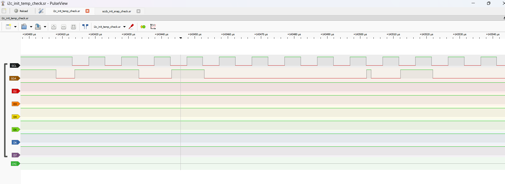

Рисунок 5. Перший байт читання температури без декодера: START, адреса, R/W і ACK.

| Фронт SCL, мкс | 9,875 | 19,750 | 29,625 | 39,500 | 49,250 | 59,125 | 69,000 | 78,875 | 88,750 |
|---|---|---|---|---|---|---|---|---|---|
| SDA | 1 | 1 | 0 | 1 | 0 | 0 | 0 | 0 | 0 |
| Біт | A6 | A5 | A4 | A3 | A2 | A1 | A0 | R/W | ACK |

Біти 1101000 старшим вперед дають адресу 0x68, восьмий біт 0 означає запис, дев'ятий 0 це ACK від MPU6050, який тримає SDA низьким. Наступні вісім фронтів (98,6-167,6 мкс) дають 01000001, тобто 0x41, і на 177,5 мкс знову ACK.

## 3. SCCB: керування камерою OV7670

У STM32F411 немає окремого інтерфейсу для камери, тому камера підключена трьома окремими інтерфейсами: SCCB для налаштування регістрів (цей розділ), тактовий сигнал XCLK з таймера і паралельна шина даних (розд. 4). SCCB іде тим самим I2C1 на PB8 і PB9, що й датчики з розд. 2, через стандартні функції HAL (`App/Src/sccb.c`). Записи нижче взяті з `i2c_init_temp_check.sr`, бо в ньому до шини не підключені дроти паралельної шини і SCCB записано без наводок.

```
  5272,9 мс  S 21 W ACK 0A ACK P                 адреса регістра PID
  5273,1 мс  S 21 R ACK 76 NACK P                PID = 76
  5273,3 мс  S 21 W ACK 0B ACK P
  5273,5 мс  S 21 R ACK 73 NACK P                VER = 73
  5330,1 мс  S 21 W ACK 12 ACK 80 ACK P          COM7 = 80, скидання регістрів
  5429,7 мс  S 21 W ACK 6B ACK 7A ACK P          DBLV = 7A, PLL x4; через 99,3 мс
  ...        ще 127 записів по одному регістру, крок 288 мкс
  5464,2 мс  S 21 W ACK 11 ACK BF ACK P          CLKRC = BF, режим CIF
  5466,5 мс  S 21 W ACK 32 ACK P
  5466,7 мс  S 21 R ACK B6 NACK P                читання HREF перед зміною
  5477,0 мс  S 21 W ACK 32 ACK 92 ACK P          запис HREF через 10,1 мс
  ...        те саме для VREF (03: 0A → 0A)
```

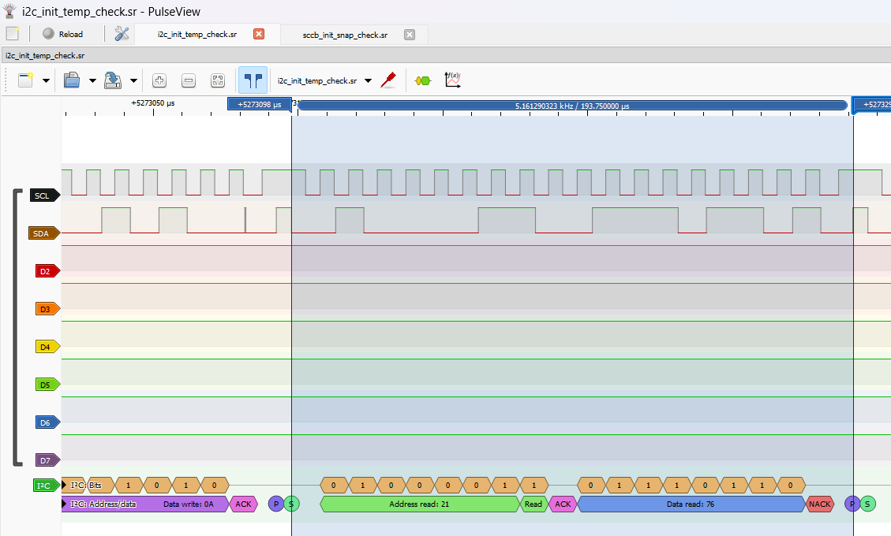

Рисунок 6. Читання PID: камера підтверджує адресу (ACK), контролер після байта 76 відповідає NACK і ставить STOP. Тривалість 193,75 мкс (курсор).

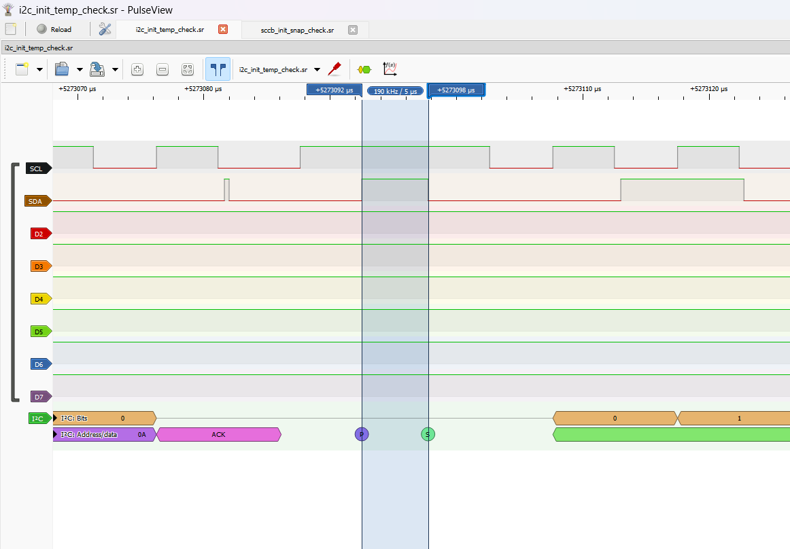

Рисунок 7. Між записом адреси регістра і читанням стоїть STOP і новий START, пауза 5 мкс (курсор).

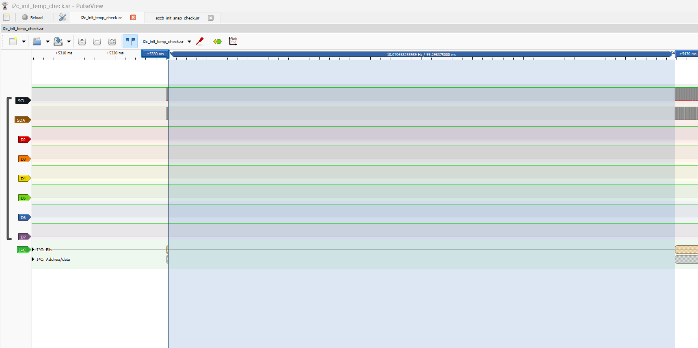

Рисунок 8. Після запису COM7 = 80 шина мовчить 99,3 мс (курсор), далі йде блок налаштування регістрів.

Адреса камери 42 для запису і 43 для читання, тобто 7-бітна 0x21 (OV7670[pg:10]). Ідентифікація камери складається з двох регістрів: PID (0x0A) і VER (0x0B), номер ревізії кристала (OV7670[pg:11]). Камера повертає 76 і 73. Прошивка порівнює з цією парою відповідь на старті: якщо вона збігається, камера вважається знайденою і прошивка переходить до налаштування регістрів.

SCCB відрізняється від I2C у двох місцях, і обидва видно на записі.

**Читання регістра.** SCCB не має повторного START: читання складається з двох окремих транзакцій, запису номера регістра (2-фазний запис) і читання (2-фазне читання), між якими стоїть STOP (SCCB[pg:9-10]). Прошивка тому не використовує `HAL_I2C_Mem_Read`, яке ставить Sr (рис. 4), а викликає `HAL_I2C_Master_Transmit` і `HAL_I2C_Master_Receive` (`hal_read_seq`). Пауза між ними 5 мкс, більше за мінімальні 1,3 мкс tBUF (OV7670[pg:6]).

**Дев'ятий біт.** У специфікації SCCB дев'ятий біт після байта, який передає контролер, позначений як «don't care»: ведений не зобов'язаний тягнути SDA вниз (SCCB[pg:9]). При читанні дев'ятий біт ставить контролер, і це NA, тобто 1 (SCCB[pg:10]). На записі OV7670 на кожному дев'ятому біті адреси і даних тримає SDA низьким, тобто фактично відповідає ACK, як I2C-пристрій (рис. 6). Через це стандартний I2C-драйвер HAL з нею працює: HAL перевіряє ACK і з веденим, який лишав би SDA високим, повернув би помилку `HAL_I2C_ERROR_AF`. Після єдиного прочитаного байта HAL ставить NACK і STOP, що збігається з NA за SCCB.

| Параметр | Очікуване значення | Виміряне значення |
|---|---|---|
| Частота SIO_C | 100 кГц, з поправкою HSI 101,3 кГц; не більше 400 кГц (OV7670[pg:6]) | 101,3 кГц |
| Низький і високий рівень SIO_C | не менше 1,3 мкс і 0,6 мкс (OV7670[pg:6]) | 5,0 і 4,9 мкс |
| 3-фазний запис регістра | 27 тактів ≈ 267 мкс, плюс START і STOP | 282,5 мкс |
| 2-фазний запис або читання | 18 тактів ≈ 178 мкс, плюс START і STOP | 193,75 мкс (курсор) |
| Пауза між транзакціями | не менше 1,3 мкс (tBUF) | 5 мкс (курсор) |
| Пауза після скидання COM7 | `HAL_Delay(100)`: 100-101 тік ≈ 98,7-99,7 мс | 99,3 мс (курсор) |
| Пауза в read-modify-write HREF і VREF | `HAL_Delay(10)`: 10-11 тіків ≈ 9,9-10,9 мс | 10,1 і 10,6 мс |

Пауза в 100 мс після скидання з запасом перекриває вимогу: регістр COM7, біт 7 скидає всі регістри, після чого камера недоступна близько 1 мс (OV7670[pg:12]). Тривалість транзакцій відрізняється від суми тактів на ту саму величину, що й для I2C, бо це той самий контролер I2C1.

У записі `sccb_init_snap_check.sr`, де до аналізатора підключені ще VSYNC, HREF і PCLK, на ділянці 5999-6036 мс декодер показує хибні транзакції: випадкові адреси і короткі START-STOP. У цей час камера вже працює з PLL x4 і перемикає PCLK і дані з частотою в десятки мегагерц, і ці фронти наводяться на дроти SCL і SDA. Та сама послідовність записів у `i2c_init_temp_check.sr` розбирається повністю, і камера підтверджує кожен байт, тож налаштування до неї доходять. Отже, хибні транзакції це завади, що потрапили в запис аналізатора, а не справжні звертання до камери.

## 4. Паралельна шина камери

Пікселі OV7670 віддає восьмибітною паралельною шиною з трьома сигналами синхронізації: VSYNC позначає початок кадру, HREF високий, поки передається рядок, на кожному зростаючому фронті PCLK на D0-D7 стоїть один байт. STM32F411 не має DCMI, тому прошивка зчитує шину програмно: у циклі опитує GPIOA (VSYNC PA1, HREF PA4, PCLK PA0) і на кожному фронті PCLK читає байт з GPIOC (D0-D7 на PC0-PC7). Тактовий сигнал XCLK формує TIM1_CH1 на PA8: 84 МГц / (ARR + 1) = 84 / 4 = 21 МГц. Восьми каналів аналізатора вистачає на SCL, SDA, VSYNC, PCLK і HREF; лінії даних D0-D7 і XCLK не записані.

```
    61,5-2518 мс   кадри 601 мс, 290 рядків           режим CIF, налаштований попереднім запуском
  2518-5711 мс     VSYNC = 1 без змін 3,19 с          МК перезапущено, XCLK немає
  5711-5995 мс     кадри 37,6 мс, 480 рядків          заводський VGA після апаратного скидання камери
  5999-6044 мс     кадри 9,4 мс                       після запису DBLV = 7A, PLL x4
  6051,6 мс і далі кадри 601,3 мс, 290 рядків,        режим CIF після CLKRC = BF
                   704 імпульси PCLK у кожному рядку
  8391-16265 мс    немає читань температури на I2C    команда SNAP
```

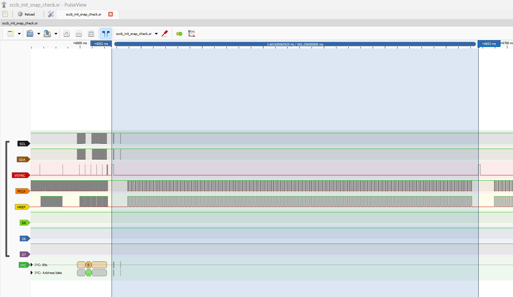

Рисунок 9. Кадр у режимі CIF: між зростаючими фронтами VSYNC 601,26 мс (курсор).

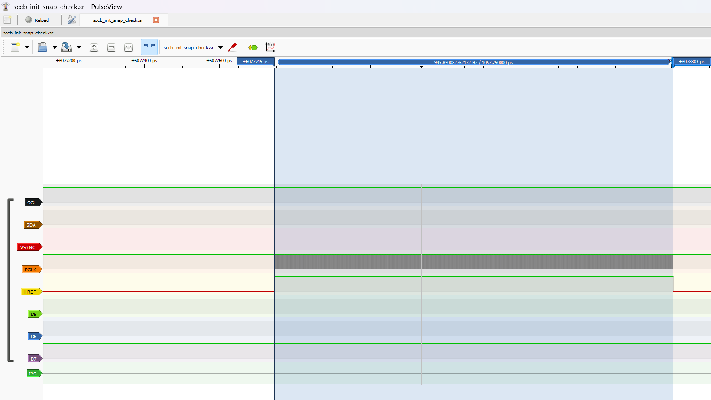

Рисунок 10. Один рядок: HREF високий 1057,25 мкс (курсор), PCLK перемикається лише всередині HREF.

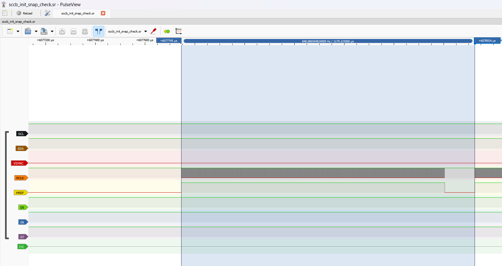

Рисунок 11. Від початку рядка до початку наступного 1179,1 мкс (курсор).

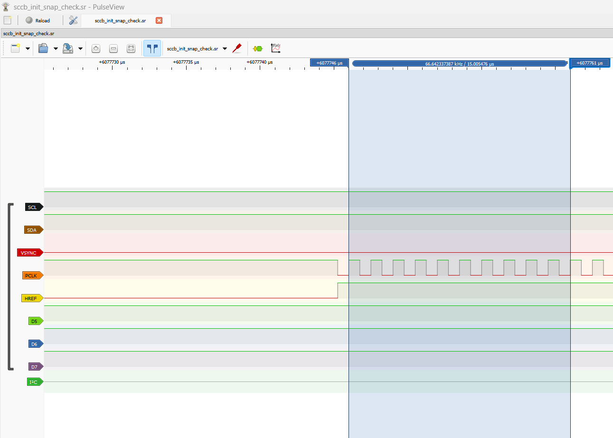

Рисунок 12. Десять періодів PCLK після підйому HREF: 15,005 мкс (курсор), 1,50 мкс на байт.

Камера отримує XCLK 21 МГц, множить його на 4 (регістр DBLV, OV7670[pg:20]) і ділить на 64 (регістр CLKRC, OV7670[pg:12]): 21 · 4 / 64 = 1,3125 МГц, з поправкою HSI 1,33 МГц, тобто такт 0,752 мкс. Один байт на виході займає два такти, тож період PCLK дорівнює 1,504 мкс. За діаграмою кадру (OV7670[pg:7]) рядок сенсора триває 784 таких періоди. З них 704 припадають на видиму частину, поки HREF високий: 352 пікселі по 2 байти. Кадр складається з 510 рядків, з яких 3 займає імпульс VSYNC.

| Параметр | Очікуване значення | Виміряне значення |
|---|---|---|
| Рядок сенсора | 784 · 1,504 = 1179 мкс | 1179,1 мкс (курсор) |
| Кадр | 510 рядків · 1179 мкс = 601,5 мс | 601,26 мс (курсор) |
| Імпульс VSYNC | 3 рядки = 3,54 мс | 3,535 мс |
| HREF | 704 · 1,504 = 1059 мкс | 1057,25 мкс (курсор), 1058,75 мкс за відліками |
| Період PCLK | 2 · 0,752 = 1,504 мкс, 665 кГц | 1,5005 мкс, 666 кГц (курсор, 10 періодів) |
| Байтів у рядку | 352 пікселі · 2 байти YUV422 = 704 | 704 імпульси PCLK у кожному з 290 рядків |
| Рядків у кадрі | 288 для CIF | 290 |
| Кадр заводського VGA | без множника і дільника такт у 16 разів коротший: 601,5 / 16 = 37,6 мс | 37,59 мс |
| Кадр з PLL x4 до зміни CLKRC | 37,6 / 4 = 9,4 мс | 9,40 мс |

Усі значення сходяться з розрахунком у межах 0,2 %. Так опосередковано підтверджується XCLK 21 МГц, яку аналізатор записати не може: за іншої частоти розійшлися б і рядок, і кадр. Те саме видно на проміжних режимах: заводське налаштування без множника і дільника дає кадр 37,6 мс, а після ввімкнення множника x4 кадр стає ще вчетверо коротшим, 9,4 мс.

Рядки йдуть нерівномірно: між сусідніми HREF то 1179 мкс, то вдвічі більше, у повторюваному порядку 1, 2, 2. Так камера зменшує кадр по вертикалі: з кожних 5 рядків сенсора віддає 3, і з 480 виходить 288 рядків CIF. На записі їх 290, а команда `SNAP` бере 288, тож два зайві рядки не заважають. Між рядками PCLK не перемикається, так його налаштовує регістр COM10 (OV7670[pg:13]). Програмному зчитуванню вистачає часу: між фронтами PCLK 1,5 мкс, а це 126 тактів процесора на 84 МГц.

Коли МК перезапускається, вивід PA8 стає входом, XCLK зникає, і камера зупиняється з VSYNC = 1 на 3,19 с, поки прошивка не дійде до `MX_TIM1_XCLK_Init`. Команду `SNAP` видно лише опосередковано: поки прошивка чекає кадр, зчитує його і передає 50 688 байтів у base64 по UART (близько 5,8 с на 115200 бод), головний цикл не виконується і читання температури на I2C пропадають на 7,9 с.

## 5. SPI: W25Q64

```
  5168,3 мс   3 фронти SCK, байти не розпізнаються       W25Q64_ReadID при старті, SCK 21 МГц
 12272,9 мс   MOSI AB             MISO FF                Release Power-down (FINIT)
 12274,8 мс   MOSI 9F FF FF FF    MISO FF EF 40 17       Read JEDEC ID
 12274,9 мс   MOSI 9F FF FF FF    MISO 7F EF 40 17       Read JEDEC ID
 15676,5 мс   MOSI 05 FF          MISO FF 00             Read Status Register-1: вільна
 15676,5 мс   MOSI 06             MISO 7F                Write Enable
 15676,5 мс   MOSI 05 FF          MISO FF 02             WEL = 1
 15676,6 мс   MOSI D8 00 00 00    MISO FF FF FF FF       Block Erase 64 КБ з адреси 0
 15676,6 мс   MOSI 05 FF          MISO FF 03             BUSY = 1, WEL = 1, ще близько 15 200 разів
 15873,8 мс   MOSI 05 FF          MISO FF 00             стирання завершено
```

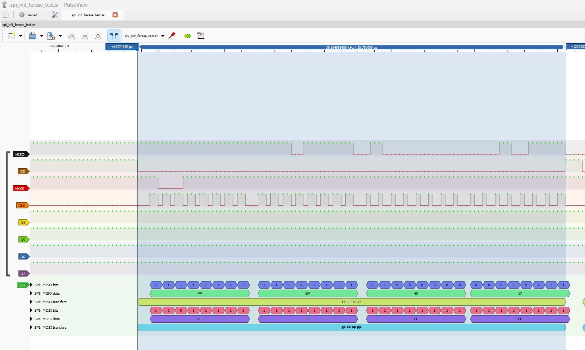

Рисунок 13. Read JEDEC ID: команда і відповідь при утриманому CS#, кадр 25,75 мкс (курсор).

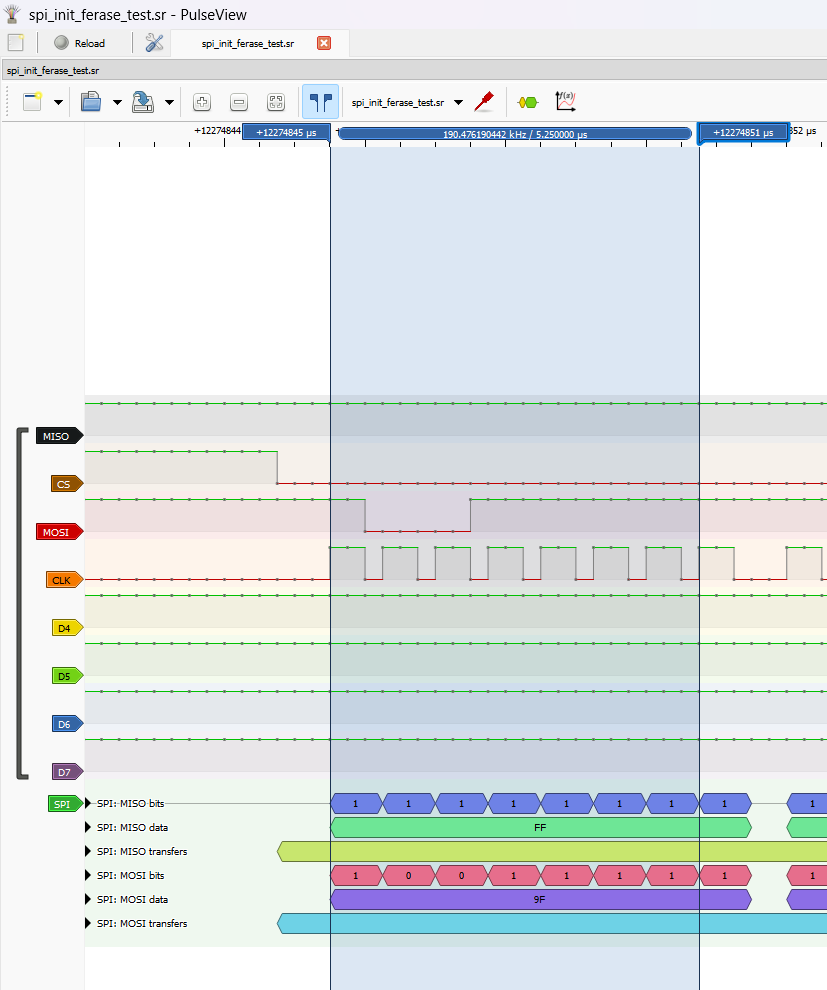

Рисунок 14. Перший байт кадру JEDEC ID: SCK низький у спокої, MOSI змінюється на спаді, сім періодів SCK 5,25 мкс (курсор).

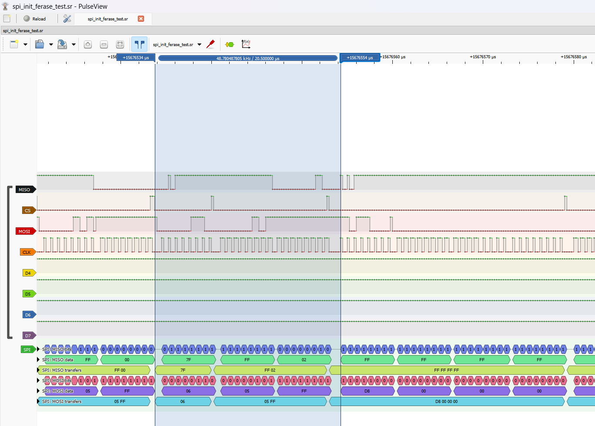

Рисунок 15. Read Status, Write Enable, Read Status з WEL = 1 і Block Erase; від спаду CS# перед 06 до початку D8 20,5 мкс (курсор).

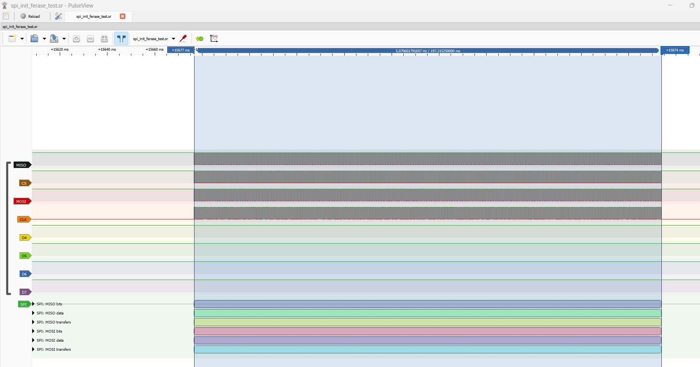

Рисунок 16. Опитування статусу від команди D8 до зняття BUSY: 197,2 мс (курсор).

Кожен рядок журналу це один кадр: від моменту, коли CS# опускається, до моменту, коли він піднімається. На команду 9F флешка відповідає трьома байтами: виробник EF (Winbond), тип пам'яті 40 і ємність 17, тобто 64 Мбіт (W25Q64JV[pg:20,48]). Перший байт MISO нічого не означає: поки флешка приймає команду, вона ще не керує лінією MISO (W25Q64JV[pg:9]), і драйвер цей байт відкидає. Тому там то FF, то 7F, залежно від рівня, що лишився на лінії після попереднього кадру.

Перед стиранням драйвер (`erase_generic` у `w25q64.c`) робить чотири кроки: перевіряє, що флешка вільна; дозволяє запис командою 06 (Write Enable); перевіряє, що дозвіл увімкнувся (біт WEL = 1); і лише тоді надсилає команду стирання D8 з адресою 000000. Без Write Enable флешка ігнорує стирання і запис, а після завершення операції дозвіл скидається сам, тому останній статус 00 (W25Q64JV[pg:23,38]). Поки йде стирання, біт BUSY = 1 (W25Q64JV[pg:13]), і драйвер читає статус знову і знову, доки той не стане 00.

Режим SPI 0 видно на рис. 14: у спокої SCK низький, MOSI змінюється на спаді SCK, а флешка зчитує його на зростаючому фронті. W25Q64 підтримує режими 0 і 3 (W25Q64JV[pg:11]), прошивка використовує 0.

| Параметр | Очікуване значення | Виміряне значення |
|---|---|---|
| Період SCK | 42 МГц / 32 = 1,3125 МГц, 762 нс (RM0383[pg:599]); з поправкою HSI 752 нс | 750 нс (5,25 мкс на 7 періодів, курсор) |
| Крок між байтами | 8 періодів = 6,0 мкс | 6,5 мкс |
| Кадр JEDEC ID | 32 такти ≈ 24 мкс | 25,75 мкс (курсор) |
| Від спаду CS# до першого фронту SCK | | 0,75 мкс |
| CS# високий між кадрами | не менше 10 нс для читання, 50 нс для запису (tSHSL, W25Q64JV[pg:62]) | 0,25-1 мкс |
| Пауза після Release Power-down | не менше 3 мкс (tRES1, W25Q64JV[pg:63]) | 1,94 мс, `HAL_Delay(1)` |
| Стирання блоку 64 КБ | tBE2 типово 150 мс, максимум 2000 мс (W25Q64JV[pg:63]) | 197,2 мс (курсор) |

Між байтами минає на 0,5 мкс більше за 8 тактів: драйвер передає байти по одному і перед кожним наступним чекає, поки піде попередній. Тривалість стирання лежить між типовим і максимальним значенням, а тайм-аут у драйвері 3000 мс більший за максимум з datasheet.

Читання ID при старті прошивки (`W25Q64_ReadID` у `main.c`) іде через `hspi2` з дільником 2, тобто SCK 21 МГц, і в записі на 4 МГц від нього лишаються три випадкові фронти. Команда `FINIT` перемикає SPI2 на дільник 32, і всі подальші кадри розбираються.

## 6. PWM: сервопривід SG92R

```
     0,2-2763,6 мс   140 імп.  1,95-2,00 мс  період 19,70-19,75 мс   кінець попереднього запуску, 180°
  2763,6-2773,8 мс     1 імп.  1,95 мс       період 10,20 мс         обірваний період, розд. 7
  2773,8-2995,2 мс     лінія в HIGH 221,35 мс                         розд. 7
  2995,2-4001,5 мс    51 імп.  0,95-1,00 мс  період 19,70-19,75 мс   0°
  4001,5-4987,7 мс    50 імп.  1,45-1,50 мс  період 19,70-19,75 мс   90°
  4987,7-13631,0 мс  438 імп.  1,95-2,00 мс  період 19,70-19,75 мс   180°
```

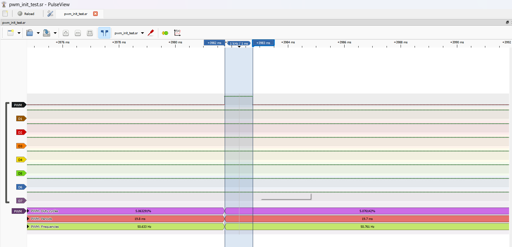

Рисунок 17. 0°: імпульс на 3982 мс, ширина 1 мс (курсор), заповнення 5,08 %.

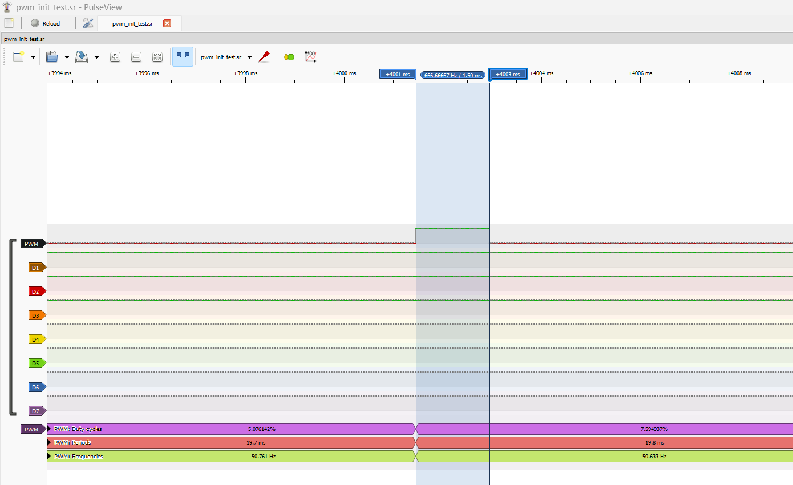

Рисунок 18. 90°: перший імпульс після `Servo_SetAngle(90)` на 4001 мс, ширина 1,50 мс (курсор), заповнення 7,59 %; ліворуч ще 5,08 %.

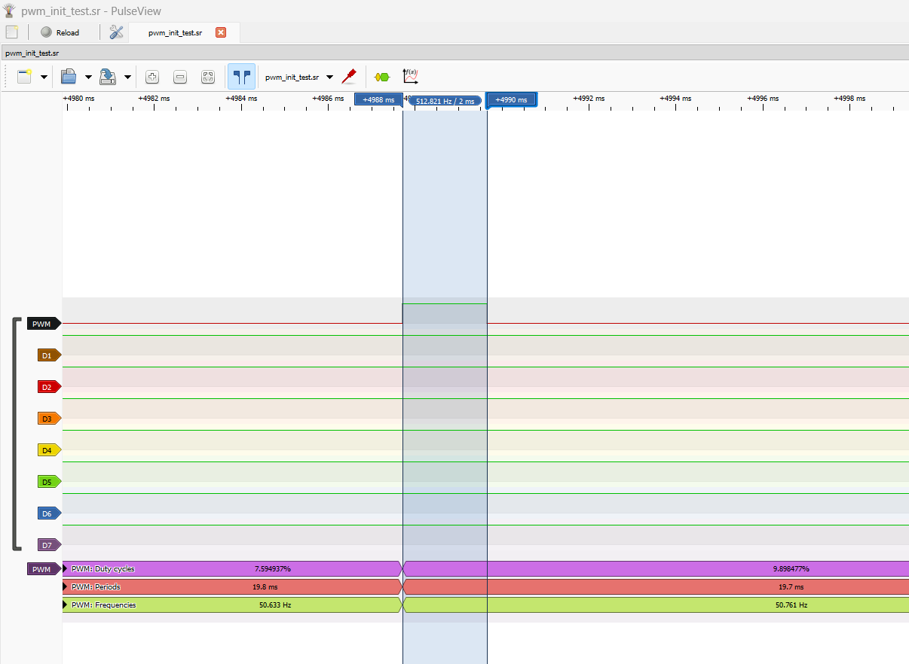

Рисунок 19. 180°: перший імпульс після `Servo_SetAngle(180)` на 4988 мс, ширина 2 мс (курсор), заповнення 9,90 %; ліворуч ще 7,59 %.

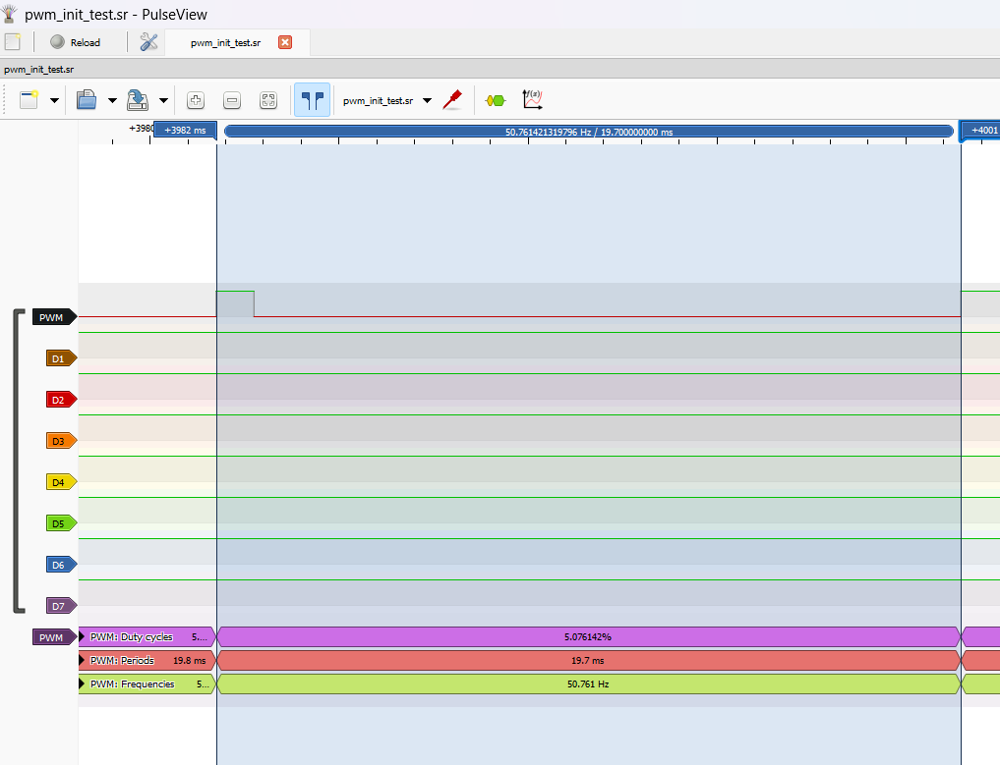

Рисунок 20. Період між передніми фронтами сусідніх імпульсів 19,70 мс, 50,76 Гц (курсор).

TIM3 сидить на APB1. Дільник APB1 не дорівнює 1, тому таймер тактується подвоєною частотою шини: 2 · 42 = 84 МГц (RM0383[pg:95]). PSC = 83 дає тік 1 мкс, ARR = 19999 дає період 20 мс, а CCR задає ширину імпульсу в мікросекундах (RM0383[pg:333]). Прошивка переводить кут у CCR як 1000 + кут · 1000 / 180, тобто 0° відповідає 1,0 мс, 90° 1,5 мс, 180° 2,0 мс. Прошивка встановлює кути по черзі 0° → 90° → 180° з паузами по `HAL_Delay(1000)`.

| Параметр | Очікуване значення | Виміряне значення |
|---|---|---|
| Період | 20 000 мкс | 19,73 мс, середнє по 679 періодах |
| Імпульс 0° | 1,000 мс | 0,95-1,00 мс |
| Імпульс 90° | 1,500 мс | 1,45-1,50 мс |
| Імпульс 180° | 2,000 мс | 1,95-2,00 мс |
| Заповнення 180° | 10,00 % | 9,87-10,13 %, у середньому 10,0 % |
| Утримання 90°, `HAL_Delay(1000)` | 1000 мс | 986,2 мс |

Роздільність запису на 20 кГц становить 50 мкс, тож ширина імпульсу визначається з точністю до одного відліку: звідси значення 1,95 і 2,00 мс. Сусідні кути відрізняються на 500 мкс, тому такої точності для перевірки сервопривода достатньо.

Середній період 19,73 мс, на 1,3 % коротший за 20 мс; усереднення по 679 періодах робить цю цифру точною. Прошивка тактується від внутрішнього генератора HSI (`RCC_OSCILLATORTYPE_HSI` у `SystemClock_Config`), а частота HSI може відхилятися до ±4 % залежно від температури (DS10314[pg:87]), тож 1,3 % у цих межах. Що відхилення дає саме тактування, підтверджують дві речі: заповнення CCR / ARR від частоти не залежить і збігається з розрахунком, а `HAL_Delay(1000)` рахує від того самого джерела і так само коротший. Сервопривід реагує на ширину імпульсу, а не на точний період, тож на його роботу це не впливає.

## 7. Аномалія: обірваний період PWM і 221 мс у HIGH після перезапуску

**Прояв.** На 2763,6 мс імпульс 1,95 мс закінчується нормально, але вже через 10,2 мс від його початку, замість 19,7 мс, лінія переходить у HIGH і тримається 221,35 мс. Після цього починається нова послідовність 0° → 90° → 180°.

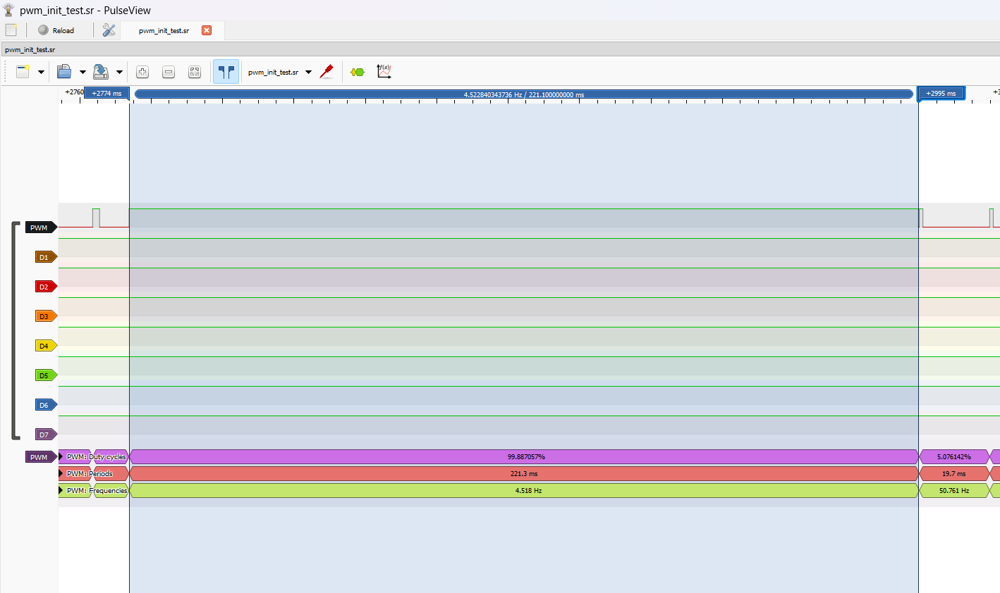

Рисунок 21. Обірваний період і лінія в HIGH 221,10 мс (курсор) до першого імпульсу 0° на 2995 мс.

**Діагностика.** Під час запису плату перезапустили кнопкою reset. До 2,76 с на виході стоять імпульси 2 мс, тобто стан після `Servo_SetAngle(180)` попереднього запуску. На reset виводи МК стають входами, і ШІМ на PA6 зникає посеред періоду. 221 мс це час від старту прошивки до `Servo_Init()`: ініціалізація HAL і периферії, вивід у UART і `I2C_Scan()`.

**Наслідок.** Поки прошивка стартує, сервопривід не отримує керуючого сигналу, а рівень HIGH поза діапазоном 1-2 мс може змусити його смикнутися при кожному перезапуску.

## Джерела

Посилання в тексті мають вигляд `КОД[pg:сторінка]`: щоб знайти документ, введіть у пошук код і слово datasheet. Номер сторінки це номер, надрукований на самій сторінці.

| Код | Документ |
|---|---|
| DS10314 | STM32F411xC/E datasheet, Rev 8, STMicroelectronics |
| RM0383 | STM32F411xC/E reference manual, Rev 4, STMicroelectronics |
| MPU-6000 | MPU-6000 and MPU-6050 Register Map and Descriptions, Rev 4.2, InvenSense |
| OV7670 | OV7670/OV7171 CMOS VGA camera chip, Version 1.01, OmniVision |
| SCCB | Serial Camera Control Bus (SCCB) Functional Specification, Version 2.1, OmniVision |
| W25Q64JV | W25Q64JV serial flash, Revision C, Winbond |
| LSM303D | LSM303D datasheet, STMicroelectronics |
| L3GD20 | L3GD20 datasheet, STMicroelectronics |
| BMP180 | BMP180 datasheet, BST-BMP180-DS000-09, Bosch Sensortec |
| UM10204 | I2C-bus specification and user manual, Rev. 7.0, NXP |
